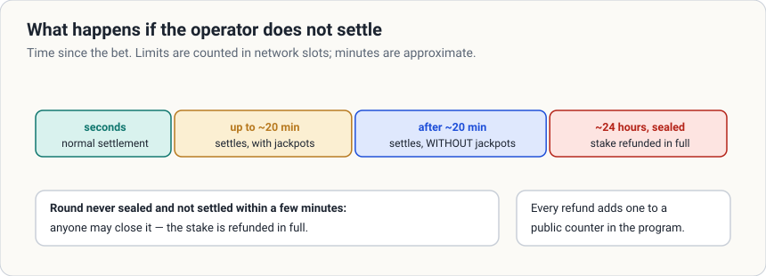
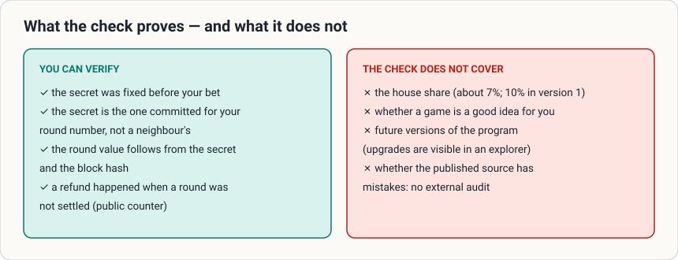
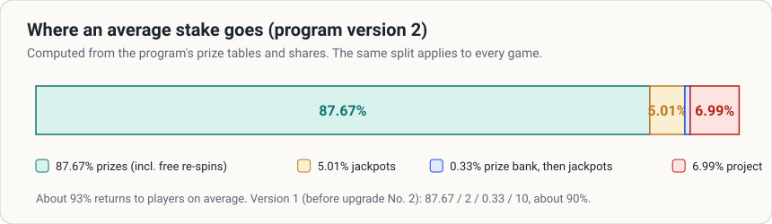

# How FAIRDRUM picks a round number — and how to check it yourself

*A plain-language walkthrough with a working checker. Written by the team behind [FAIRDRUM](https://fairdrum.to); this is not an independent review.*

FAIRDRUM runs games of chance for SOL on Solana. The outcome of every round is computed by a Solana program, not by the website. A claim like that is only worth something if a player can test it without trusting us. This page explains the scheme step by step, shows the arithmetic on real numbers, and gives you a small tool that repeats it on your own computer.

It also says, just as plainly, what the check does **not** prove.

**Contents**

1. [The problem](#1-the-problem)
2. [Two halves of one number](#2-two-halves-of-one-number)
3. [Life of one round](#3-life-of-one-round)
4. [How one hash commits to a million secrets](#4-how-one-hash-commits-to-a-million-secrets)
5. [A worked example with real numbers](#5-a-worked-example-with-real-numbers)
6. [Check your own round](#6-check-your-own-round)
7. [What if the operator simply does nothing?](#7-what-if-the-operator-simply-does-nothing)
8. [Why we removed the oracle](#8-why-we-removed-the-oracle)
9. [What the check does not prove](#9-what-the-check-does-not-prove)
10. [Where an average stake goes](#10-where-an-average-stake-goes)
11. [Questions](#11-questions)

---

## 1. The problem

A game needs a number nobody can know in advance. On a public blockchain that is harder than it sounds:

- If the **operator** picks the number, the operator can pick one that suits it.
- If the number comes from the **blockchain itself** (a block hash), whoever builds the block sees it first and can choose whether to include a bet.
- If the number comes from an **outside service**, you now trust that service — and, as section 8 shows, such a service can fail in ways that are easy to miss.

The usual answer is to combine two sources so that no single party controls the result. That is what this scheme does.

## 2. Two halves of one number


The round value is one SHA-256 hash over two inputs:

```
round value = SHA-256( "fairdrum-round-salt-v1" || secret || hash of the bet's block )
```

- The **secret** is known only to the operator — but it is fixed *before* your bet, because a fingerprint of all secrets is already stored in the program (section 4).
- The **block hash** is known to nobody at the time of the bet: the block does not exist until the network has included your transaction.

The operator cannot pick a convenient secret after seeing the block, because the secret was committed earlier. The player cannot predict the outcome, because the secret is hidden until the reveal. Every prize in the round is derived from this one value by the program.

## 3. Life of one round


1. **Commit.** The operator generates a list of secrets and writes their Merkle root — one 32-byte hash — into the program.
2. **Bet.** Your transaction is given the next secret number in order. The program records which root is active at that moment. From here on, the secret for your round cannot be swapped.
3. **Block closes.** The network finalises the block containing your bet. Its hash becomes the second half.
4. **Reveal.** The operator's service sends the secret together with a proof that it belongs to the recorded root.
5. **Settle.** In the same transaction the program verifies the proof, computes the round value and credits the prizes.

A bet and its settlement cannot share a block: the program rejects that, because the bet's block hash only exists once the next block has started.

## 4. How one hash commits to a million secrets

Publishing a million hashes in advance would be expensive. A Merkle tree compresses them into one.


Each secret is hashed into a *leaf*. Leaves are hashed in pairs, the results are hashed in pairs again, and so on until one hash remains — the *root*. The exact rules, the same in the program and in this repository:

```
leaf = SHA-256( 0x00 || secret number (8 bytes, little-endian) || secret )
node = SHA-256( 0x01 || left child || right child )
```

The leading `0x00` and `0x01` bytes keep a leaf from being passed off as an inner node. The secret number is part of the leaf, so a secret cannot be moved to another position.

To show that one secret belongs to the root you do not need the other secrets. You need only the sibling hash at each level on the way up: three hashes in the picture, twenty for a tree of 1,048,576 secrets.

## 5. A worked example with real numbers

The file [`test/vectors.json`](test/vectors.json) holds a small tree of 64 secrets. Take secret number 1:

| | Value |
|---|---|
| Secret | `3e2e9716…c9c33704` |
| Leaf = SHA-256(00, number 1, secret) | `96fe8856…d01cd62e` |
| Level 1: secret 1 is a right child, so SHA-256(01, sibling, leaf) | `31832453…37ac6db1` |
| Level 2 (left child) | `1df6c5fa…d23dd0c8` |
| Level 3 | `f3b69a2d…837ff418` |
| Level 4 | `3e49bd4b…9f7a55ea` |
| Level 5 | `9fef76b0…c2d08c88` |
| Level 6 = root | `cba9fdbc…73e506ba` |

The last line equals the root that was committed for this tree, so the secret is genuine. Change a single character of the secret, of any sibling hash or of the secret number, and the final hash is completely different — the tests in this repository do exactly that.

With a block hash of `0909…09` (32 bytes) the round value for this secret is `3afc8ff0…0b99a54e`.

Run it yourself — Node.js 18 or newer, nothing to install, nothing sent over the network:

```
node --test
```

## 6. Check your own round

Every settlement transaction publishes what you need:

- the event `RoundRevealed` carries the secret number, the root, the secret and the salt (the block hash);
- the settle instruction carries the proof.

**In the browser.** Paste the transaction signature into [fairdrum.to/verify.html](https://fairdrum.to/verify.html). The page reads the transaction from the network and repeats the arithmetic on your device.

**On your own computer**, without our site:

```
node verify.mjs --index <secret number> --secret <hex> --proof <hex,hex,...> --root <hex> --salt <hex>
```

The tool prints the root it computed, the committed root, `OK` or `FAIL`, and the round value.

One more step matters: the root in the event should be one the program actually stored *before* your bet. The program keeps the current root and the eight before it, and each change of root is itself a public transaction with a timestamp.

You do not need to check every round. Checking a few at random, and always the ones that surprised you, is enough to make systematic cheating in this part of the scheme very likely to be caught.

## 7. What if the operator simply does nothing?

Only the operator knows the secrets, so only the operator can settle a round. A scheme like this has to say what happens when it does not.



- Normally a round is settled within seconds.
- If a round is neither sealed nor settled within about 4–5 minutes, anyone may close it and the **stake is refunded in full**.
- A round can be *sealed* — its block hash recorded — by anyone; the site normally does this itself a few seconds after the bet. A sealed round waits for the operator; settled later than about 20 minutes after the bet it pays ordinary prizes **without the jackpot draw**.
- If a sealed round's secret is still not revealed after about 24 hours, the stake is refunded in full.

Every refund increments a public counter in the program. Nobody loses a stake to operator downtime — but a late settlement costs the player the jackpot chance, and that is a real cost.

## 8. Why we removed the oracle

The first version used an outside randomness service (a "VRF oracle"). Before launch we ran a simple test: send the same request on the test network and on the main network and compare the answers.

**They were identical.** The service's number was a set of signatures over the request text, made with the same keys on both networks. Anyone could have asked the free test network first and learned the "random" number of a main-network round in advance.

We measured this on 13 November 2026, removed the oracle and replaced it with the scheme on this page. The lesson is general: an outside source of randomness is one more thing that has to be checked, and "it is an oracle" is not a proof. We are not naming the service here until it has had time to respond.

## 9. What the check does not prove



A verified round means the secret was fixed before the bet and the outcome follows from it. It does not mean the game is a good idea, or that the operator is trustworthy in other ways.

- **The house share is about 10%.** Verification says nothing about that; see the next section.
- **The operator can withhold a secret.** The stake comes back, but there is no outcome. An operator that also plays could, in principle, withhold only its own losing rounds. The public refund counter makes this visible; it does not prevent it.
- **Collusion with a block producer is not excluded.** Whoever builds the bet's block knows its hash first. Predicting a result still needs the operator's secret as well, so this takes the operator and that validator acting together.
- **One key can upgrade the program.** The rules you verify today can be changed by the holder of that key.
- **The program's source code is not published yet**, there has been no external audit, the team is anonymous, and the project holds no gambling licence. What you can check today is what the program *does* on-chain, not how it is written.

## 10. Where an average stake goes



The split is computed from the program's prize tables and is the same for every game: 87.67% is paid as prizes (including free re-spins), 2% feeds the jackpots, 0.33% stays in the prize bank, and 10% goes to the project.

That is roughly a 90% average return. Many competing sites advertise a smaller house share. A fair draw and a favourable game are two different things; this page is about the first.

Other figures worth knowing before you play: the smallest round is 0.1 SOL, and a deposited amount cannot be withdrawn for 12 hours (winnings are not locked).

## 11. Questions

**Can the operator change a secret after seeing my bet?**
No. The program compares the revealed secret with the root it recorded when you bet. A different secret does not lead to that root.

**Can I predict the result from earlier secrets?**
No. Each secret is derived through a one-way hash from a master value only the operator holds; the secrets already revealed say nothing about the next one.

**Does "verified" mean I will be paid?**
The prize is credited by the same transaction that settles the round, so there is no separate payout step to wait for. Withdrawal is a transaction you sign yourself. Neither statement covers a future program upgrade.

**Why trust this page, written by the operator?**
Do not. Run the tool, read the one short file [`verify.mjs`](verify.mjs), and compare the root in your round with the one stored in the program at `5ww3w4HrQrrrPcjfxVRvjLpL5vBJqLt7M5ThsnEkkngf`.

---

## Files

| File | What it is |
|---|---|
| [`verify.mjs`](verify.mjs) | the checker: library functions and a command-line tool, no dependencies |
| [`test/verify.test.mjs`](test/verify.test.mjs) | tests, run with `node --test` |
| [`test/vectors.json`](test/vectors.json) | a reference tree: root, four leaves with proofs, one round value |
| [`tools/make-img.mjs`](tools/make-img.mjs) | the script that draws the diagrams above |

## Links

- Project: [fairdrum.to](https://fairdrum.to)
- Round check in the browser: [fairdrum.to/verify.html](https://fairdrum.to/verify.html)
- Live state of the program: [fairdrum.to/status.html](https://fairdrum.to/status.html)

Games of chance have a negative expected value for the player. 18+ only. Gambling may be illegal where you live — check your local law. If gambling is causing you harm, free help is available at [gamblingtherapy.org](https://www.gamblingtherapy.org).

## Licence

MIT — see [`LICENSE`](LICENSE).
