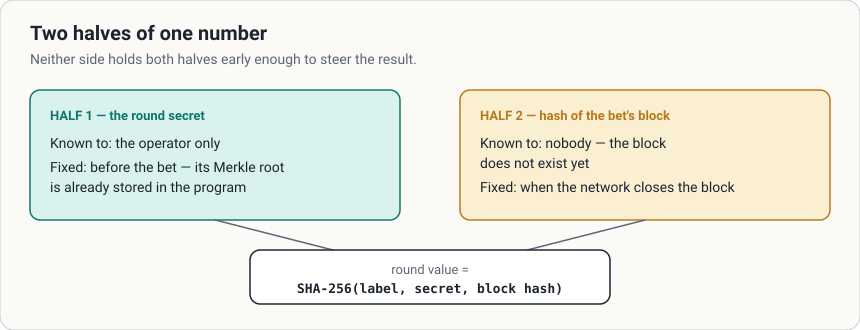
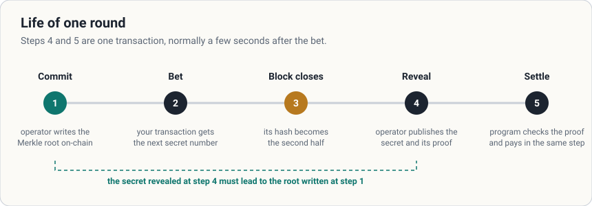
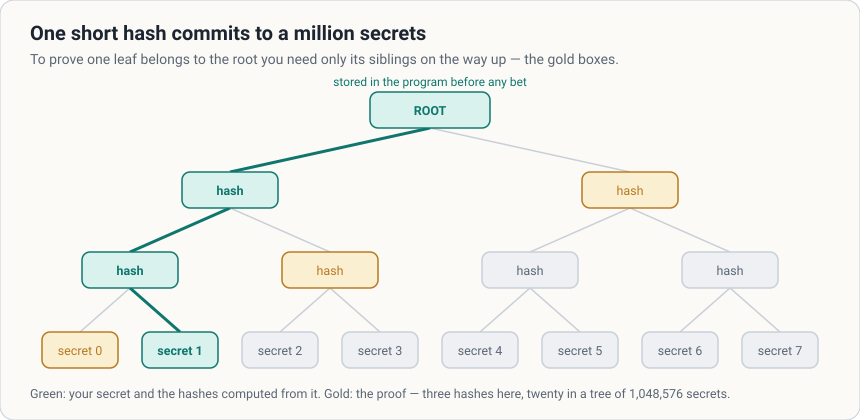

# How FAIRDRUM picks a round number and how to check it yourself

*An explanation of the scheme with a working checker. Written by the team behind [FAIRDRUM](https://fairdrum.to); this is not an independent review.*

FAIRDRUM runs games of chance for SOL on Solana. The outcome of every round is computed by a Solana program, not by the website. A claim like that is worth something only if a player can test it without trusting us. This page explains the scheme and works through the arithmetic on real numbers; the small tool in this repository repeats it on your own computer.

[Section 9](#9-what-the-check-does-not-prove) lists what the check does **not** prove.

**Contents**

1. [The problem](#1-the-problem)
2. [Two halves of one number](#2-two-halves-of-one-number)
3. [Life of one round](#3-life-of-one-round)
4. [How one hash commits to a million secrets](#4-how-one-hash-commits-to-a-million-secrets)
5. [A worked example with real numbers](#5-a-worked-example-with-real-numbers)
6. [Check your own round](#6-check-your-own-round)
7. [What if the operator simply does nothing?](#7-what-if-the-operator-simply-does-nothing)
8. [Why there is no oracle](#8-why-there-is-no-oracle)
9. [What the check does not prove](#9-what-the-check-does-not-prove)
10. [Where an average stake goes](#10-where-an-average-stake-goes)
11. [Questions](#11-questions)

---

## 1. The problem

A game needs a number nobody can know in advance. On a public blockchain each obvious source has a flaw:

- If the **operator** picks the number, the operator can pick one that suits it.
- If the number comes from the **blockchain itself** (a block hash) alone, it is public the moment the block appears, and nothing about it is fixed before the bet.
- If the number comes from an **outside service**, you now trust that service as well.

This scheme combines two sources so that no single party controls the result.

## 2. Two halves of one number



The round value is one SHA-256 hash over two inputs:

```
round value = SHA-256( "fairdrum-round-salt-v1" || secret || hash of the bet's block )
```

- The **secret** is known only to the operator, but it is fixed *before* your bet, because a fingerprint of all secrets is already stored in the program (section 4).
- The **block hash** does not exist at the time of the bet: the block is made only when the network includes your transaction. The first to know it is the validator that produces that block (section 9 says what that means).

**Which value exactly.** "Hash of the bet's block" is the entry the Solana network records for the bet's slot in its `SlotHashes` list (account `SysvarS1otHashes111111111111111111111111111`): the slot's *bank hash*. It is **not** the `blockhash` field an explorer shows for a block, so the two differ; that is expected. The program reads the value from that account itself and takes none from the sender of a transaction. Any node returns the account, and it keeps a slot for about 3.5 minutes (512 slots); afterwards the value stays published in the settlement's `RoundRevealed` event (the field `salt`).

The operator cannot pick a convenient secret after seeing the block, because the secret was committed earlier. The player cannot predict the outcome, because the secret is hidden until the reveal. Every prize in the round is derived from this one value by the program.

## 3. Life of one round



1. **Commit.** The operator generates a list of secrets and writes their Merkle root, one 32-byte hash, into the program.
2. **Bet.** Your transaction is given the next secret number in order. The program records which root is active at that moment. From here on, the secret for your round cannot be swapped.
3. **Block closes.** The network finalises the block containing your bet. Its hash becomes the second half.
4. **Reveal.** The settlement transaction carries the secret together with a proof that it belongs to the recorded root.
5. **Settle.** In the same transaction the program verifies the proof, computes the round value and credits the prizes.

A bet and its settlement cannot share a block: the program rejects that, because the bet's block hash only exists once the next block has started.

## 4. How one hash commits to a million secrets

Publishing a million hashes in advance would be expensive. A Merkle tree compresses them into one.



Each secret is hashed into a *leaf*. Leaves are hashed in pairs, the results are hashed in pairs again, and so on until one hash remains, the *root*. The exact rules, the same in the program and in this repository:

```
leaf = SHA-256( 0x00 || secret number (8 bytes, little-endian) || secret )
node = SHA-256( 0x01 || left child || right child )
```

The leading `0x00` and `0x01` bytes keep a leaf from being passed off as an inner node. The secret number is part of the leaf, so a secret cannot be moved to another position.

To show that one secret belongs to the root you do not need the other secrets. You need only the sibling hash at each level on the way up: three hashes in the picture, twenty for a tree of 1,048,576 secrets.

## 5. A worked example with real numbers

The file [`test/vectors.json`](test/vectors.json) holds a small tree of 64 secrets. Take secret number 1:

| | Value |
|---|---|
| Secret | `3e2e9716…c9c33704` |
| Leaf = SHA-256(00, number 1, secret) | `96fe8856…d01cd62e` |
| Level 1: secret 1 is a right child, so SHA-256(01, sibling, leaf) | `31832453…37ac6db1` |
| Level 2 (left child) | `1df6c5fa…d23dd0c8` |
| Level 3 | `f3b69a2d…837ff418` |
| Level 4 | `3e49bd4b…9f7a55ea` |
| Level 5 | `9fef76b0…c2d08c88` |
| Level 6 = root | `cba9fdbc…73e506ba` |

The last line equals the root that was committed for this tree, so the secret is genuine. Change a single character of the secret, of any sibling hash or of the secret number, and the final hash is completely different; the tests in this repository do that.

With a block hash of `0909…09` (32 bytes) the round value for this secret is `3afc8ff0…0b99a54e`.

To run it yourself you need Node.js 18 or newer. Nothing is installed and nothing is sent over the network:

```
node --test
```

## 6. Check your own round

Every settlement transaction publishes what you need:

- the event `RoundRevealed` carries the secret number, the root, the secret and the salt (the "block hash" of section 2: the `SlotHashes` entry of the bet's slot, not the explorer's `blockhash`);
- the settle instruction carries the proof.

**In the browser.** Paste the transaction signature into [fairdrum.to/verify.html](https://fairdrum.to/verify.html). The page reads the transaction from the network and repeats the arithmetic on your device.

**On your own computer**, without our site:

```
node verify.mjs --index <secret number> --secret <hex> --proof <hex,hex,...> --root <hex> --salt <hex>
```

The tool prints the root it computed, the committed root, `OK` or `FAIL`, and the round value.

**The prizes too (rounds settled after program upgrade No. 2).** The check above tells you the round NUMBER is honest. Since
upgrade No. 2 the program also publishes, in the settlement transaction itself, every input the prizes are computed from
(the event `RoundInputs`: the game, the number of stakes, the prize bank and the three pots at that moment, the amounts
recorded at the bet). With it the whole round can be repeated, stake by stake, and compared with what the program paid:

```
node verify.mjs --tx <signature of the settlement transaction> --rpc <address of a Solana node>
```

Without `--rpc` the public main-network node is asked; it keeps only recent transactions, so for an old round name a node
with the full history. The tool asks that node for this one transaction and nothing else. To check with no network at all,
save the transaction once and read it from the file:

```
node verify.mjs --tx <signature> --rpc <node> --save round.json
node verify.mjs --tx-file round.json
```

What it prints (a real round from a test network; the last line is the verdict, exit code 0):

```
secret → root : OK   — the revealed secret belongs to this root (proof of 10 hashes)
round value   : 2b3bea1a2f50dc174a88597f5605253412a8bd610e95b50fb2e627e1e2c23937
contract paid : 286 stakes executed (36 re-spins), 32 on gold · table prizes 2.240000000 SOL (largest 0.500000000 SOL) · mini ×0 … · jackpot ×0 … · super ×0 …
round         : wheel · ×250 stakes · settled on time · prize bank at settlement 197.823133000 SOL
re-computed   : 286 stakes executed (36 re-spins), 32 on gold · table prizes 2.240000000 SOL (largest 0.500000000 SOL) · mini ×0 … · jackpot ×0 … · super ×0 …
PRIZES MATCH  — the contract paid exactly what the published inputs and the round value give, field by field.
```

`PRIZES DO NOT MATCH` (exit code 1) names the fields that differ. For a round settled before the upgrade the tool says that
the inputs were not published then and checks the round number only (exit code 3). The arithmetic is in
[`recompute.mjs`](recompute.mjs), about 400 lines with the rules written out at the top; it is the code the site's own
"Verify a round" page runs. `node --test` checks it against 3,748 rounds (about 259,000 stakes) that the program's own Rust
engine wrote, every game, every pot, cut prizes and late settlements included, and against a saved real transaction.

What this adds and what it does not: it shows that the program paid what ITS published rules and inputs give. The inputs
(the size of the prize bank and of the pots at that moment) are the program's own record; that they follow from all the
earlier rounds is checked by repeating those rounds the same way.

One more thing to check: the root in the event should be one the program actually stored *before* your bet. The program keeps the current root and the eight before it, and each change of root is itself a public transaction with a timestamp.

You do not need to check every round. Checking a few at random, and always the ones that surprised you, is enough to make systematic cheating in this part of the scheme very likely to be caught.

## 7. What if the operator simply does nothing?

Only the operator knows the secrets, so only the operator can settle a round. A scheme like this has to say what happens when it does not.


- Normally a round is settled within seconds.
- If a round is neither sealed nor settled within a few minutes, anyone may close it and the **stake is refunded in full**.
- A round can be *sealed* (its block hash recorded) by anyone; normally this happens a few seconds after the bet. A sealed round waits for the operator; settled later than about 20 minutes after the bet it pays ordinary prizes **without the jackpot draw**.
- If a sealed round's secret is still not revealed after about 24 hours, the stake is refunded in full.

Every refund increments a public counter in the program. Nobody loses a stake to operator downtime, but a late settlement costs the player the jackpot chance.

## 8. Why there is no oracle

Many games take their random number from an outside service. That adds one more party that has to be trusted and checked. The scheme on this page needs nothing outside the Solana network itself: one half of the number is fixed in the program before the bet, the other half is produced by the network after it.

## 9. What the check does not prove


A verified round means the secret was fixed before the bet and the outcome follows from it. It does not mean the game is a good idea, or that the operator is trustworthy in other ways.

- **The project takes a share of every stake.** Verification says nothing about that; see the next section.
- **If the operator does not reveal a secret, there is no outcome.** The stake comes back in full, and the case is counted in a public refund counter.
- **The program can be upgraded.** Every upgrade is visible in any Solana explorer.
- **The program's source code is published separately** (the source of version 2; see Links). Version 2 has been on the network since 18 November 2026; rounds before that day were settled by version 1, whose bytes are not a build of that source. The README of the source repository names the upgrade transaction and says how to compare the bytes. There has been no external audit, the team is anonymous, and the project holds no gambling licence.
- **A settlement whose transaction log was cut by the node ("Log truncated") is not verified by this tool.** The events this check reads are part of the transaction log; whoever sends a transaction can pad it so that the node cuts the log. For a settlement that is the operator (only the operator holds the round's secret). No funds move because of it, but such a round cannot be re-computed from its own transaction: treat it as unverified and ask why.
- **The validator that produces the bet's block knows the second half first, and can influence it** by choosing what goes into the block. Alone that predicts nothing. An outcome can be known or chosen in advance only by someone who has both halves: the holder of the secrets acting together with the producer of that very block. Block producers follow the network's public, stake-weighted schedule and change every few slots; this check cannot exclude such cooperation.
- **The administrator may play, and whoever holds the secrets decides whether a round is settled.** The project's share of the administrator's own stakes returns to the project, so in version 2 his own play costs him nothing on average. A refunded or late-settled round is listed in [`refunds/`](refunds).

## 10. Where an average stake goes


The figures below are those of **program version 2** (upgrade No. 2). They apply from 18 November 2026, the day that upgrade was applied; the table after them gives version 1.

The split is computed from the program's prize tables and shares and is the same for every game: of an average paid stake **87.67%** is paid as table prizes (including free re-spins), **5.01%** feeds the three jackpots (super jackpot 3.31%, jackpot 1.20% with its seed, mini 0.50%), **6.99%** goes to the project, and **0.33%** stays in the prize bank until the bank holds 1,600 SOL; what the bank holds above that moves by itself to a reserve that restarts the jackpot and the mini after a win. Nobody, the project included, can take it out.

That is an average return of about **93%** (92.7% while the prize bank is still below 1,600 SOL, 93.0% after). A fair draw is not the same as a favourable game, and this page is only about the draw.

Other figures worth knowing before you play: the smallest round is 0.1 SOL; a top-up can be withdrawn at once; a jackpot win is computed from at most 3 starting amounts (2.5 targets for the super jackpot), the jackpot winner receives 76% of that amount (4% goes to the super jackpot, 20% stays in the pot for the next winner), the mini winner two thirds (a third stays), the super jackpot winner 90% (10% stays). Whatever the pots hold, a stake is worth at most 98.4% of itself on average.

| | version 1 (until 18 November 2026) | version 2 |
|---|---|---|
| table prizes | 87.67% | 87.67% |
| jackpots | 2% | 5.01% (+0.33% through the prize bank) |
| stays in the prize bank | 0.33%, for good | 0.33% until the bank holds 1,600 SOL |
| project | 10% | 6.99% |
| average return | about 90% | about 93% |
| withdrawal after a top-up | after 12 hours | at once |

Which version is on the network is visible to anyone: a version-2 settlement carries the `RoundInputs` event, and the upgrade itself is a public transaction ([status page](https://fairdrum.to/status.html)).

## 11. Questions

**Can the operator change a secret after seeing my bet?**
No. The program compares the revealed secret with the root it recorded when you bet. A different secret does not lead to that root.

**Can I predict the result from earlier secrets?**
No. A revealed secret says nothing about the next one, and a secret cannot be recovered from the root.

**Does "verified" mean I will be paid?**
The prize is credited by the same transaction that settles the round, so there is no separate payout step to wait for. Withdrawal is a transaction you sign yourself. Neither statement covers a future program upgrade.

**Why trust this page, written by the operator?**
Do not. Run the tool, read the one short file [`verify.mjs`](verify.mjs), and compare the root in your round with the one stored in the program at `5ww3w4HrQrrrPcjfxVRvjLpL5vBJqLt7M5ThsnEkkngf`.

---

## Files

| File | What it is |
|---|---|
| [`verify.mjs`](verify.mjs) | the checker: library functions and a command-line tool, no dependencies |
| [`recompute.mjs`](recompute.mjs) | the prizes of a round re-computed from the published inputs (program upgrade No. 2), no dependencies |
| [`test/verify.test.mjs`](test/verify.test.mjs), [`test/recompute.test.mjs`](test/recompute.test.mjs) | tests, run with `node --test` (17 tests) |
| [`test/vectors.json`](test/vectors.json) | a reference tree: root, four leaves with proofs, one round value |
| [`test/fixtures/recompute-vectors.json.gz`](test/fixtures) | 3,748 rounds written by the program's Rust engine: inputs, every stake, totals |
| [`test/fixtures/settlement-localnet-1.json`](test/fixtures) | a settlement transaction saved from a test network (a local node running the program at its main-network address) |
| [`refunds/`](refunds) | the published reports of refunded and late-settled rounds, checked with `node verify.mjs --refunds <file>` |
| [`tools/make-img.mjs`](tools/make-img.mjs) | the script that draws the diagrams above |

## Links

- Project: [fairdrum.to](https://fairdrum.to)
- Source of the program (version 2): [github.com/fairdrum/fairdrum-program](https://github.com/fairdrum/fairdrum-program) (its README has the build hash and how to compare it with the network)
- Round check in the browser: [fairdrum.to/verify.html](https://fairdrum.to/verify.html)
- Live state of the program: [fairdrum.to/status.html](https://fairdrum.to/status.html)

Games of chance have a negative expected value for the player. 18+ only. Gambling may be illegal where you live — check your local law. If gambling is causing you harm, free help is available at [gamblingtherapy.org](https://www.gamblingtherapy.org).

## Licence

MIT — see [`LICENSE`](LICENSE).
